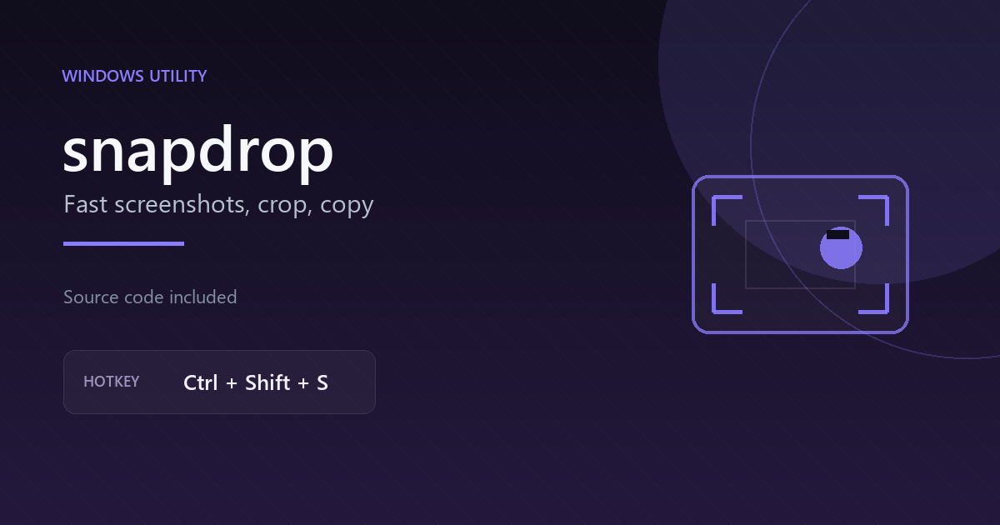

# snapdrop

Small screenshot tool for Windows. Capture a rectangle, a window, the full screen or use a timer. The image is saved locally and copied to your clipboard.



## What it does

* Rectangle capture with a drag overlay
* Full screen capture
* Active window capture
* Delayed capture
* Global hotkey, default `Ctrl + Shift + S`
* Tray menu
* Local screenshot history
* Toast message with a quick preview

## Run it

1. Install Python 3 for Windows.
2. Open a terminal in this folder.
3. Install the packages:

```bat
pip install pillow pynput pystray pywin32
```

4. Run:

```bat
python main.py
```

The app starts in a small window and adds a tray icon. Close the window to keep it running in the tray.

## Notes

The app creates `config.json` and a `screenshots` folder the first time you use it. Those are ignored by the root `.gitignore` and should not be uploaded.

`pywin32` is used for copying the image to the Windows clipboard. Everything stays on your PC. There are no accounts and no network calls.

## Settings

You can change the hotkey, toast duration, local saving and startup with Windows from the settings panel.
